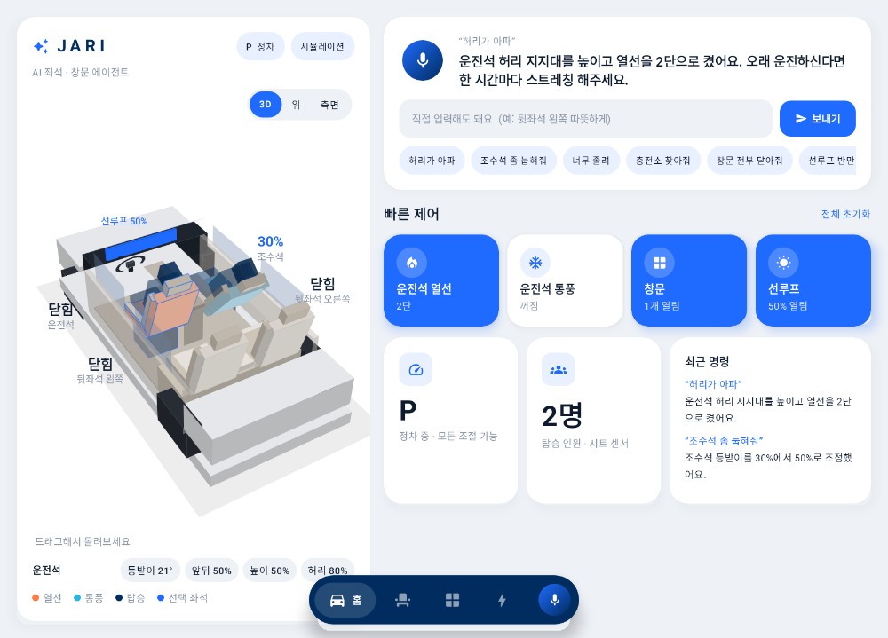
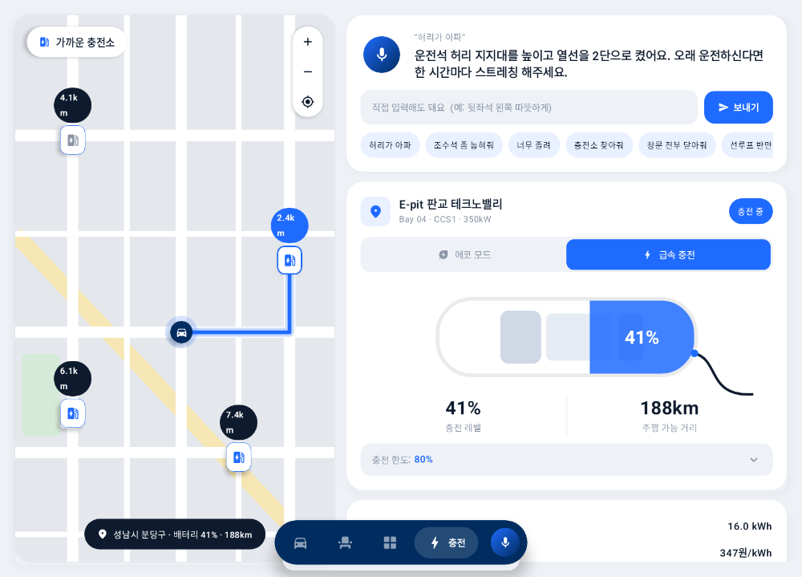
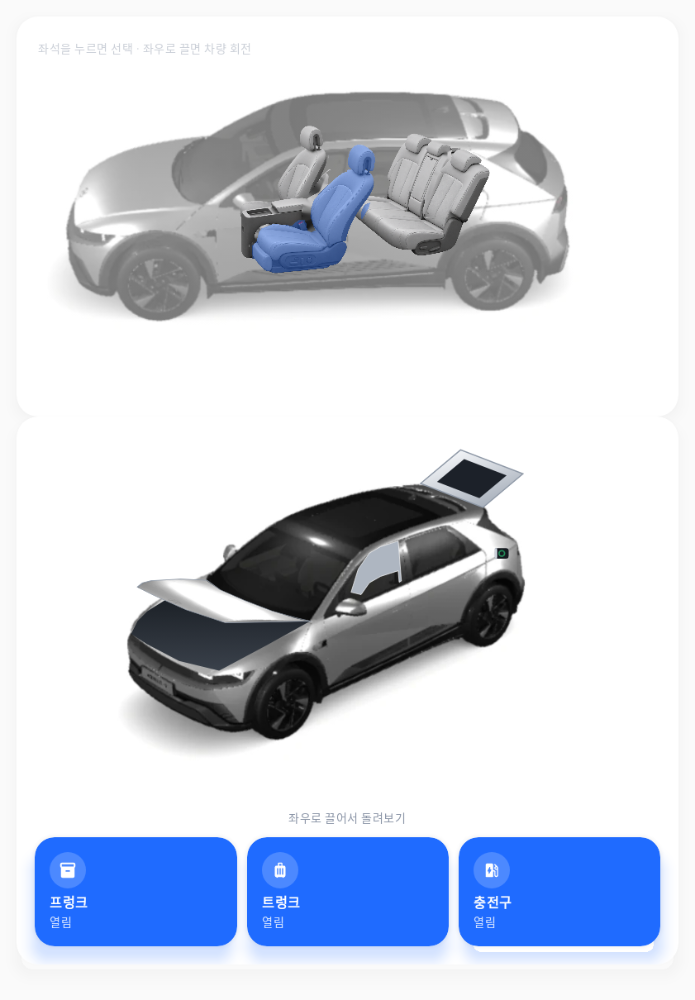
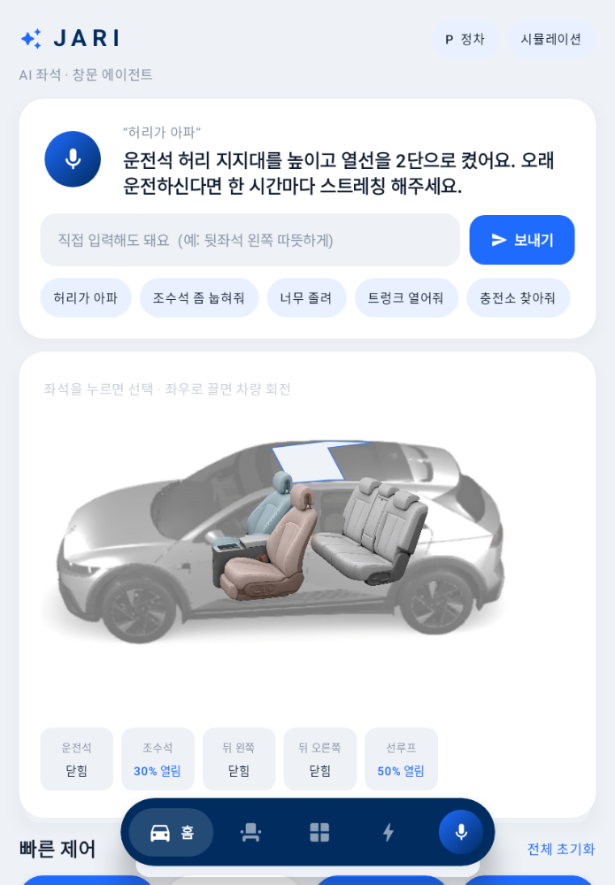

# JARI — AI 좌석·창문 에이전트 (Pleos Connect)

> 말 한마디로 내 자리를 맞춰주는 차량용 AI 에이전트. "허리가 아파", "조수석 좀 눕혀줘", "너무 졸려".



## 핵심 기능
- **음성 에이전트**: Pleos STT(ON_DEVICE) → 의도 해석 → Vehicle SDK 실행 → Pleos TTS 응답
- **좌석 제어**: 4개 좌석 × 앞뒤·등받이·높이·허리 지지 + 열선·통풍 (0~3단)
- **창문 제어**: 측면 4개 + 선루프, 환기 모드
- **주행 안전 가드**: 기어가 P가 아니면 운전석 자세를 크게 바꾸는 명령 차단 (음성·터치 공통)
  - 예) 주행 중 "졸려" → 눕히는 대신 창문 20% + 통풍 3단 + 휴게소 안내
- **복합 문장**: "조수석 눕히고 열선 켜줘" → 절 단위로 나눠 모두 실행, 좌석 지칭은 앞 절에서 이어받음
- **먼저 챙기기** (`CareMonitor`): 요청이 없어도 차량 신호를 보고 JARI가 먼저 말을 건다
  - 연속 운전 2시간마다 허리 지지대 위치를 바꾸고 휴식 권유 / 장거리 후 정차 시 휴식 자세 제안 / 배터리 20% 이하 충전소 안내 제안
  - debug 빌드는 시연용으로 1초를 1분으로 센다(D 기어로 2분이면 발동). release 빌드는 실제 시간
- **상황 프리셋**: 휴식 / 운전 자세 / 승하차 / 초기화
- 시트 점유 센서로 "모두" 명령 시 탑승한 좌석만 조절
- **EV 충전**: 가까운 충전소 지도·목록·상세, "충전소 찾아줘" → 빈 충전기 중 최단거리로 NaviHelper 길안내
  - 충전 세션: 실시간 SoC, 충전 한도 설정, 충전량·요금
  - **충전 중 휴식**: 충전이 시작되면 시트를 휴식 모드로, 끝나면 운전 자세로 자동 복귀
  - 충전소 데이터는 데모용 고정값 (`Charging.kt`) — 공공 충전소 API로 교체 예정



## 실내 시트 모션 (`ui/Cabin3D.kt`)
- 실사 시트 아트워크를 부위별 레이어(앞좌석 등받이·방석, 뒷좌석 60:40 등받이)로 분리 (`design/cut_seats.py`)
- 시트 값 그대로 움직임: 앞뒤 = 레일 방향 이동, 높이 = 상하 이동, 등받이 = 힌지 기준 회전, 허리 지지 = 발광
- 시트는 실차 옆모습 안에 놓여 있고, 좌석을 누르면 그 좌석이 파랗게 물든다(마커·글자 없음)
- 차를 좌우로 끌면 회전하고 놓은 각도에 머문다. 시트는 옆모습에서만 보이며 "좌석 보기"로 돌아온다
- 구동 중인 부위는 파랗게 깜빡이고, 열선·통풍은 시트 표면 색으로 표시. 선루프는 열린 만큼 지붕이 뚫려 보인다
- 시트 모터: 기본은 시간 기반 구동, 구동 중 `registerSeat*Position` 실제 위치가 들어오면 그 값으로 목표 도달 시 정지

## 차량 외관 (`ui/Exterior.kt`)
- 실차 렌더 턴테이블(`res/drawable-nodpi/car_00..64.webp`): 좌우로 끌면 360° 회전, 기본 각도에서 열리는 부위를 겹쳐 그림
- 트렁크·프렁크·충전구 버튼(음성: "트렁크 열어줘") → 실제 개폐 속도로 열리고 닫히는 모션
- 앞·뒤 창문 유리가 창문 값만큼 내려감, 충전 중이면 충전구 링이 깜빡임
- 주행 중에는 열기 동작 차단(닫기는 허용)



## 화면 구성 (Pleos 멀티 윈도우)
- **portrait** (기본, window 1개 ≈ 841×1210): 음성 에이전트 → 실내 시각화 → 핵심 제어. 내비와 나란히 사용
- **landscape** (window 2개 ≈ 1682×1210): 실내 탑뷰·시트 측면 뷰 + 확장 제어
- 주행 중(기어 ≠ P): 키보드 입력 숨김, 시트 화면 조작 잠금, 음성만 허용 (Pleos 주행 규제 `NO_KEYBOARD`·`NO_SETUP` 준수)
- 글자 크기: Pleos 디자인 가이드는 물리 높이(주요 정보 5mm, 보조 3mm)를 요구한다. 현재 본문 14sp가 많아 실차 화면에서 점검 필요



## 사용 SDK / 권한
| SDK | API | 권한 |
|---|---|---|
| Vehicle 2.3.2 | `Seat.moveSeat{ForeAft,BackrestAngle,Height,LumbarForeAft}`, `setHvacSeat{Temperature,Ventilation}`, `getCurrentSeatOccupancy` | `CAR_SEATS`, `CONTROL_CAR_SEATS` |
| Vehicle 2.3.2 | `Window.setWindowPosition`, `checkWindowPositionCapabilities` | `CAR_WINDOWS`, `CONTROL_CAR_WINDOWS` |
| Vehicle 2.3.2 | `Seat.getCurrentSeat*Position`, `registerSeat*Position`, `checkSeat*PositionCapabilities` | `CAR_SEATS` |
| Vehicle 2.3.2 | `Door.setDoorPosition(REAR / HOOD)`, `registerDoorPosition`, `checkDoorPositionCapabilities` | `CAR_DOORS`, `CONTROL_CAR_DOORS` |
| Vehicle 2.3.2 | `EvBattery.setEvChargePortOpen`, `registerEvChargePortOpen` | `CAR_ENERGY` / `CONTROL_CAR_ENERGY` |
| Vehicle 2.3.2 | `Gear.registerGearSelection` | `CAR_DRIVE` |
| Vehicle 2.3.2 | `EvBattery.getEvBatteryStateOfCharge`, `registerEvBatteryStateOfCharge` / `setEvChargeSwitch`, `setEvChargePercentLimit` | `CAR_ENERGY` / `CONTROL_CAR_ENERGY` |
| NaviHelper 3.0.5 | `requestRoute(RouteInfo)` | `NAVI_ROUTE` |
| SpeechToText 3.3.1 | `request / stop`, `ResultListener` (ON_DEVICE) | `STT_SERVICE` |
| TextToSpeech 3.3.1 | `speak` (ON_DEVICE) | `TTS_SERVICE` |

## 실행 방법
1. Android Studio + Pleos Connect Emulator v2.1.0 (API 34) 준비 — `SETUP.md`
2. `./gradlew installDebug` 또는 저장소 루트 `apk/JARI_release.apk` 설치
3. 런처에서 **JARI** 실행. 마이크 버튼 또는 추천 문장/입력창 사용
- Vehicle Service가 없는 환경에서는 자동으로 **시뮬레이션 모드** (우상단 칩 표시). 이때 `P 정차` 칩을 눌러 주행/정차 전환 가능

## 테스트 환경
- JDK 17, AGP 8.8.2, Kotlin 2.0.21, compileSdk 35, minSdk 28
- 단위 테스트(에이전트 규칙·안전 가드): `./gradlew testDebugUnitTest`
- 화면 스냅샷 재생성: `./gradlew recordPaparazziDebug` → `app/src/test/snapshots/images`

## APK
`apk/팀명_JARI_release.apk` (제출 시 팀명으로 변경)

## 구조
```
app/src/main/java/com/jari/agent/
  Agent.kt          발화 → 제어 계획 + 안전 가드 (순수 Kotlin, 테스트 대상)
  CarController.kt  Pleos Vehicle SDK 브리지 + 시뮬레이션
  Charging.kt       충전소 데모 데이터
  Voice.kt          Pleos STT/TTS 래퍼
  MainActivity.kt   연결
  ui/               Compose 화면 (App, Cabin3D, Exterior, ChargeScreens, Theme)
```
