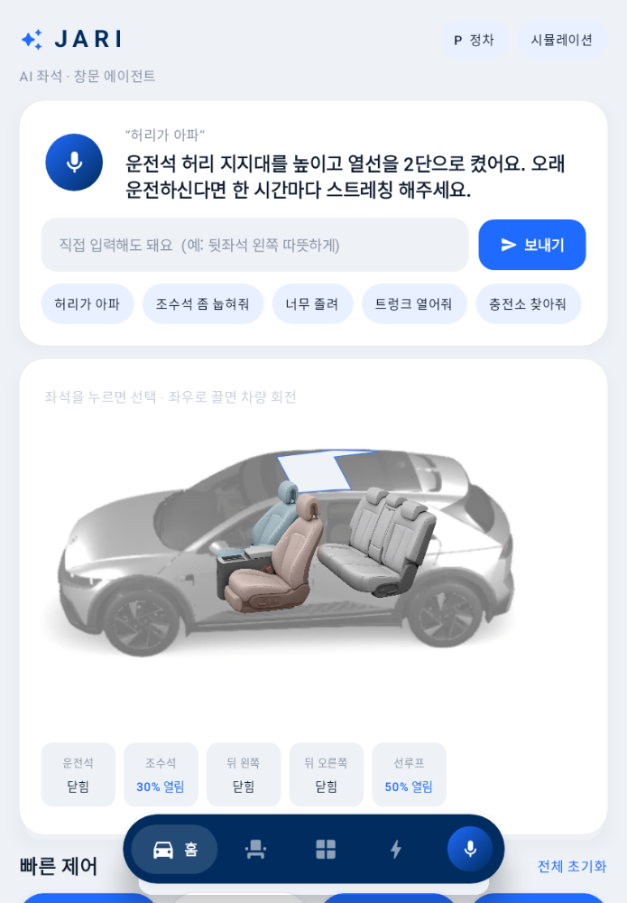

# JARI (자리) — 몸 상태를 말하면 자리를 맞춰주는 차량 AI 에이전트

> "허리가 아파", "너무 졸려"처럼 **기능이 아니라 몸 상태를 말하면** 시트·창문·열선/통풍을 알아서 조합하고,
> 말하지 않아도 2시간째 운전 중이면 먼저 자세를 바꿔 주는 Pleos Connect 앱입니다.

- 팀명: **GoAim**
- APK: [`apk/GoAim_JARI_release.apk`](apk/GoAim_JARI_release.apk) (release 빌드)
- 소스: [`03_app/`](03_app) — 기능·구조·SDK 사용 상세는 [`03_app/README.md`](03_app/README.md)



## 주요 기능
- **음성 에이전트**: Pleos STT(ON_DEVICE) → 발화 해석 → Vehicle SDK 실행 → Pleos TTS 응답. 복합 문장("조수석 눕히고 열선 켜줘") 지원
- **좌석·창문 제어**: 4개 좌석 앞뒤·등받이·높이·허리 지지 + 열선·통풍, 측면 창문 4개 + 선루프, 트렁크·프렁크·충전구
- **주행 안전 가드**: 기어가 P가 아니면 운전석 자세 큰 변경·열기 동작 차단, 주행 중 키보드 입력 숨김(음성만 허용)
- **먼저 챙기기**: 연속 운전 2시간마다 허리 지지대 변경·휴식 권유, 배터리 20% 이하 충전소 안내, 장거리 후 정차 시 휴식 제안
- **EV 충전**: 빈 충전기가 있는 가장 가까운 충전소로 NaviHelper 길안내, 충전 중 휴식 자세 → 충전 종료 시 운전 자세 복귀

## 실행 방법
1. Pleos Connect 에뮬레이터(v2.1.0)를 실행합니다. 설치 방법: [`03_app/SETUP.md`](03_app/SETUP.md)
2. APK를 설치합니다.
   ```bash
   adb install -r apk/GoAim_JARI_release.apk
   ```
   (에뮬레이터 창에 APK 파일을 끌어다 놓아도 됩니다.)
3. 런처에서 **JARI**를 실행하고 마이크 버튼을 누르거나, 추천 문장·입력창을 사용합니다.
   - 예) "허리가 아파", "조수석 좀 눕혀줘", "너무 졸려", "충전소 찾아줘", "트렁크 열어줘"

소스에서 빌드할 때 (JDK 17):
```bash
cd 03_app
./gradlew assembleRelease        # app/build/outputs/apk/release/app-release.apk
./gradlew testDebugUnitTest      # 에이전트 규칙·안전 가드 단위 테스트
```

## 테스트 환경 및 필요한 설정
| 항목 | 내용 |
|---|---|
| 개발·테스트 에뮬레이터 | **Pleos Connect Emulator v2.1.0** (Android Automotive, API 34) |
| 화면 규격 | Pleos 멀티 윈도우 기준 세로 창 1개 ≈ **841×1210**, 가로(창 2개) ≈ **1682×1210** — 두 레이아웃 모두 대응 |
| 추가 확인 환경 | Android Emulator Pixel 8 (API 35, 1080×2400) — 시뮬레이션 모드 |
| 빌드 | JDK 17, AGP 8.8.2, Kotlin 2.0.21, compileSdk/targetSdk 35, minSdk 28 |
| 사용 SDK | Vehicle 2.3.2, SpeechToText 3.3.1, TextToSpeech 3.3.1, NaviHelper 3.0.5 |

**필요한 설정**
- Pleos 권한(`CAR_SEATS`, `CONTROL_CAR_WINDOWS`, `NAVI_ROUTE_SEARCH`, `STT_SERVICE` 등)은 Manifest에 선언돼 있어 별도 설정이 필요 없습니다.
- 음성 입력을 쓰려면 에뮬레이터의 마이크 접근을 허용해야 합니다. ([Pleos 에뮬레이터 설정 가이드](https://document.pleos.ai/docs/connect/guide/getting-started/application-development/configure-pleos-connect-emulator))
- Pleos STT/TTS가 없는 환경에서는 안드로이드 기본 음성인식·TTS로 대체하며, 처음 마이크를 누를 때 마이크 권한을 요청합니다.
- Vehicle 서비스에 연결할 수 없으면 자동으로 **시뮬레이션 모드**로 실행됩니다. 오른쪽 위 **시뮬레이션** 칩을 누르면 기어(P/D), 배터리 잔량, 탑승 좌석을 바꿔 볼 수 있습니다.
  - 예) D 주행 + 배터리 20% 이하 → JARI가 먼저 충전소 안내를 제안
  - "2시간 연속 운전" 알림은 release 빌드에서 실제 시간(2시간)으로 셉니다. debug 빌드(`./gradlew installDebug`)는 시연용으로 1초를 1분으로 세서 D 상태 2분이면 알림이 나옵니다.
- Pleos 내비가 없는 환경에서는 충전소 길안내를 앱 안에서 시뮬레이션합니다.

## APK 위치
[`apk/GoAim_JARI_release.apk`](apk/GoAim_JARI_release.apk)

## 저장소 구조
```
03_app/        Android(Kotlin, Jetpack Compose) 앱 소스
apk/           release APK
02_기획서/     기획서 초안, 화면 시안
01_공모요강/   공모 요강 정리, 접수 양식
```
